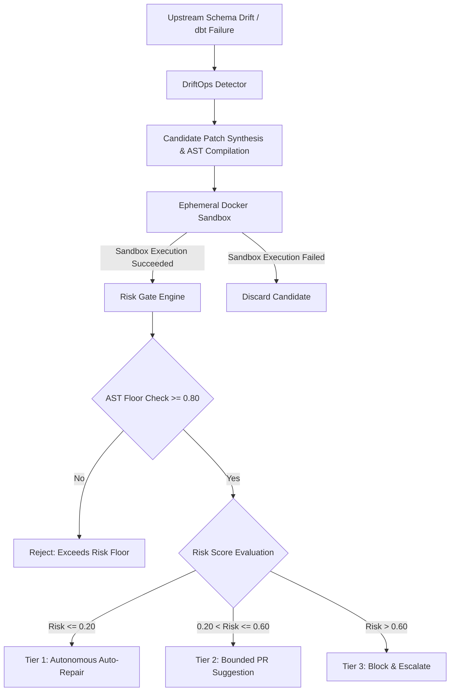

# DriftOps: Inline Repair & Verification Gate for dbt-core Pipelines

[](https://github.com/HUZAIFA23901/F26-176-DriftOps/actions/workflows/ci.yml)

**Project ID:** `F26-176-DriftOps`  
**Target Environment:** Python 3.10 / 3.11 | dbt-core 1.7+ | PostgreSQL | Docker


---

## 1. Executive Summary & Architecture Overview

**DriftOps** is an inline repair and verification gate engineered for modern analytics engineering workflows running `dbt-core`. In enterprise data platforms, upstream operational schema modifications (column renames, type mutations, dropped fields, and relation migrations) frequently induce breaking failures downstream in dbt DAG compilation and execution.

Traditional recovery relies on tedious human diagnosis, manual SQL patching, and slow multi-iteration CI cycles. DriftOps automates this loop deterministically by providing:

1. **Schema & Failure Detection (`src/detector`)**: Captures dbt compile/run errors, correlates dialect differentials, and computes candidate column/relation mappings using Jaro-Winkler string distance and AST metrics.
2. **SQL AST Analysis & Compilation (`src/compiler`)**: Utilizes `sqlglot` to parse Jinja/SQL models into Abstract Syntax Trees, comparing original vs repaired structures to evaluate semantic preservation.
3. **Ephemeral Docker Sandbox (`src/sandbox`)**: Spawns isolated PostgreSQL container instances (`postgres:15-alpine`) to test candidate fixes against seed schemas and real queries in sub-second cycles without polluting staging environments.
4. **Deterministic Risk Gate (`src/gate`)**: Evaluates candidate patches against strict structural floors:
   - **Hard Gate ($C_{\text{AST}} \ge 0.80$)**: Requires structural AST similarity $\ge 80\%$ to block hallucinated or destructive query alterations.
   - **Tier 1 Autonomous ($\le 20\%$ Risk)**: Safely merges and commits inline non-breaking repairs (e.g., unambiguous column aliasing).
   - **Tier 2 Bounded Candidate ($20\% - 60\%$ Risk)**: Emits verified suggested patches to pull requests with full audit diffs.
   - **Tier 3 Rejection ($> 60\%$ Risk)**: Halts pipeline, alerts on-call data engineers, and blocks CI.
5. **Orchestrator & Ops UI (`src/orchestrator`, `src/dashboard`)**: Exposes FastAPI endpoints for webhook triggers, posts PR status checks and inline comments via PyGithub, and provides a Streamlit operational dashboard.



---

## 2. Repository Scaffolding

```text
driftops/
├── src/
│   ├── __init__.py           # Package root & metadata
│   ├── config.py             # Pydantic BaseSettings environment validation
│   ├── compiler/             # SQL parsing, AST representation, sqlglot & dbt integration
│   │   └── __init__.py
│   ├── sandbox/              # Docker container management & ephemeral Postgres sandbox
│   │   └── __init__.py
│   ├── gate/                 # Verification, AST floor evaluation & risk tiers
│   │   └── __init__.py
│   ├── detector/             # Schema drift detection & failure diagnostics
│   │   └── __init__.py
│   ├── orchestrator/         # FastAPI webhooks & GitHub PR coordination
│   │   └── __init__.py
│   └── dashboard/            # Streamlit operations dashboard
│       └── __init__.py
├── tests/
│   ├── __init__.py
│   └── test_config.py        # Configuration and threshold test suite
├── testbed/                  # Sandbox test seeds, fixtures, and repro projects
├── .env.example              # Template environment variables
├── .env                      # Local runtime environment file (git-ignored)
├── .gitignore                # Comprehensive ignore rules
├── requirements.txt          # Python dependencies
└── README.md                 # Project documentation & quickstart
```

---

## 3. Quickstart & Installation

Follow the steps below to initialize and verify the local development environment.

### Step 1: Clone Repository & Navigate to Workspace
```bash
git clone https://github.com/your-org/driftops.git
cd driftops
```

### Step 2: Initialize Virtual Environment

**Linux / macOS:**
```bash
python3 -m venv venv
source venv/bin/activate
```

**Windows (PowerShell):**
```powershell
python -m venv venv
.\venv\Scripts\Activate.ps1
```

**Windows (Command Prompt):**
```cmd
python -m venv venv
venv\Scripts\activate.bat
```

### Step 3: Install Core Dependencies
Ensure pip is current, then install all project requirements:
```bash
pip install --upgrade pip
pip install -r requirements.txt
```

### Step 4: Configure Environment Variables
Copy `.env.example` to `.env` and adjust credentials as required:
```bash
# Linux / macOS
cp .env.example .env

# Windows (PowerShell)
Copy-Item .env.example -Destination .env

# Windows (Command Prompt)
copy .env.example .env
```

### Step 5: Execute Test Suite
Confirm the environment and configuration module pass all verification tests:
```bash
pytest -v
# or via CLI runner:
python main.py --run-tests
```

### Step 6: Run Live DriftOps Demonstrator
Execute the live end-to-end Column Rename (`customer_phone` -> `contact_number`) repair gate:
```bash
python main.py --demo-class1
```

---

## 4. Environment Variables Reference

| Variable | Type | Default | Description |
| :--- | :--- | :--- | :--- |
| `POSTGRES_HOST` | `str` | `localhost` | PostgreSQL host for target database or local proxy. |
| `POSTGRES_PORT` | `int` | `5432` | PostgreSQL listener port (1 - 65535). |
| `POSTGRES_USER` | `str` | `postgres` | Database username. |
| `POSTGRES_PASSWORD` | `str` | `postgres` | Database password. |
| `POSTGRES_DB` | `str` | `driftops_db` | Primary database name. |
| `DOCKER_SOCKET` | `str` | `unix:///var/run/docker.sock` | Socket path or named pipe for Docker daemon communication. |
| `SANDBOX_POSTGRES_IMAGE`| `str`| `postgres:15-alpine` | Lightweight Docker image for ephemeral sandbox containers. |
| `HARD_GATE_C_AST_FLOOR` | `float`| `0.80` | Hard gate: minimum structural AST similarity score ($0.0 - 1.0$). |
| `TIER_1_MAX_RISK` | `float`| `0.20` | Tier 1 ceiling: upper risk threshold for autonomous repairs ($0.0 - 1.0$). |
| `TIER_2_MAX_RISK` | `float`| `0.60` | Tier 2 ceiling: upper risk threshold for bounded candidate review ($0.0 - 1.0$). |
| `GITHUB_TOKEN` | `str` | `mock_token` | GitHub API token for check runs and PR review comments. |
| `LOG_LEVEL` | `str` | `INFO` | Application log verbosity (`DEBUG`, `INFO`, `WARNING`, `ERROR`, `CRITICAL`). |

---

## 5. Development Roadmap (Mid-1 Evaluation Milestone)

- [x] **Step 1:** Foundation setup, Pydantic settings, environment scaffolding, and directory layout.
- [x] **Step 2:** Target PostgreSQL warehouse simulator and dbt-core testbed (`docker-compose.yml`, `testbed/`).
- [x] **Step 3:** AST Parsing Engine, Structural Confidence Calculator ($C_{\text{AST}}$), and AST Rule Validator (`src/compiler/`).
- [x] **Step 4:** Ephemeral Docker sandbox lifecycle and verification harness (`src/sandbox/`).
- [x] **Step 5:** Deterministic risk gating algorithms and threshold enforcement (`src/gate/`).
- [x] **Step 6:** End-to-end pipeline orchestrator (`src/orchestrator/`), CLI demonstrator (`main.py`), and E2E verification (`tests/test_e2e.py`).
- [ ] **Step 7:** FastAPI CI/CD webhook orchestrator & GitHub PR integration (`src/orchestrator/`).
- [ ] **Step 8:** Operations telemetry dashboard in Streamlit (`src/dashboard/`).

---

## 6. Continuous Integration & Quality Assurance

DriftOps utilizes an automated GitHub Actions CI pipeline executing across Python 3.10 and 3.11 runtimes:
- Multi-version matrix testing on `ubuntu-latest`.
- Compile-time syntax validation (`compileall`) across all source and test modules.
- Full unit and integration verification via `pytest`.
- Automated smoke testing of the end-to-end CLI orchestrator (`python main.py --demo-class1`).

For in-depth architecture details and local testing instructions, refer to the [CI/CD Pipeline Guide](docs/CI_CD_PIPELINE.md).

---

## 7. Project Contributors

| Name | Role / Area | GitHub / Email |
| :--- | :--- | :--- |
| **Huzaifa** | Core Pipeline Orchestrator, Decision Engine, Risk Gates | [@HUZAIFA23901](https://github.com/HUZAIFA23901) |
| **Zeeshan Sajid** | AST Parser, SQLGlot Transforms, End-to-End CLI | [@zeeshansajid361](https://github.com/zeeshansajid361) |
| **Adnan** | UC-08 Evaluate Risk Gate ($C_{\text{AST}}$, $D_{\text{impact}}$, $R$), Execution Tiers & CI/CD Pipeline | [adnanfreelancer75500@gmail.com](mailto:adnanfreelancer75500@gmail.com) |

Detailed contributor breakdown and milestone records are maintained in [CONTRIBUTORS.md](CONTRIBUTORS.md).

