# DriftOps CI/CD Automation & Quality Assurance Pipeline

**Project ID:** `F26-176-DriftOps`  
**Target Environments:** Python 3.10 / 3.11 | Ubuntu Latest | GitHub Actions  

---

## 1. Overview & Purpose

The **DriftOps Continuous Integration (CI) Pipeline** guarantees deterministic reliability across all components of the inline repair and verification gate. Because schema drift repair involves Abstract Syntax Tree (AST) rewriting, SQL translation, and ephemeral containerized sandbox testing, every commit and pull request must adhere to zero-regression standards.

The workflow is defined in [`.github/workflows/ci.yml`](../.github/workflows/ci.yml) and executes automatically on:
- Every push to `main` or `staging` branches.
- Every pull request targeting `main` or `staging`.
- On-demand manual invocation via `workflow_dispatch`.

---

## 2. Pipeline Architecture & Stages

```mermaid
flowchart LR
    A[Trigger: Push / PR / Dispatch] --> B[Checkout Code]
    B --> C[Setup Matrix: Py 3.10 & Py 3.11]
    C --> D[Restore / Cache Pip Wheels]
    D --> E[Install Dependencies requirements.txt]
    E --> F[Syntax & Static Analysis compileall]
    F --> G[Run Pytest Verification Suite]
    G --> H[Run End-to-End CLI Smoke Demo]
    H --> I[Quality Gate: Success / Failure]
```



### 2.1 Multi-Version Python Matrix
Enterprise data pipelines frequently bridge multiple Python runtimes. DriftOps formally targets Python 3.10 and 3.11:
- Matrix builds are isolated and run concurrently on `ubuntu-latest`.
- Dependency caching is keyed by operating system, Python version, and a SHA-256 hash of `requirements.txt`.
- `fail-fast: false` ensures all matrix targets run to completion so version-specific bugs can be diagnosed independently.

### 2.2 Static Analysis & Bytecode Verification
Before running dynamic tests, all files under `src/`, `tests/`, and root scripts are compiled using:
```bash
python -m compileall src/ tests/ main.py
```
This catches syntax errors, unclosed constructs, invalid type annotations, or import anomalies without needing runtime container startup.

### 2.3 Automated Pytest Verification Suite
The automated test runner executes tests across all core subsystems:
- **`test_ast_parser.py`**: Validates deterministic SQL AST parsing and column aliasing rewrites.
- **`test_config.py`**: Ensures Pydantic environment configurations load valid fallback values.
- **`test_gate.py`**: Asserts hard safety gate enforcement ($C_{\text{AST}} \ge 0.80$, zero test failures).
- **`test_sandbox.py`**: Verifies ephemeral Postgres sandbox lifecycle and dbt test runner outputs.
- **`test_e2e.py`**: Tests end-to-end integration and tier assignment logic.

### 2.4 End-to-End CLI Demonstrator Verification
To ensure that production CLI and developer tooling remain unbroken, the CI pipeline verifies the CLI entry point:
```bash
python main.py --help
python main.py --demo-class1
```
This confirms that the terminal visual runlog outputs correctly and the end-to-end orchestration pipeline executes cleanly.

---

## 3. Local Execution Guide

To reproduce the CI pipeline locally before submitting a pull request:

```bash
# 1. Install dependencies
pip install -r requirements.txt

# 2. Run static syntax check
python -m compileall src/ tests/ main.py

# 3. Run full pytest suite
pytest -v

# 4. Verify CLI scenario
python main.py --demo-class1
```
